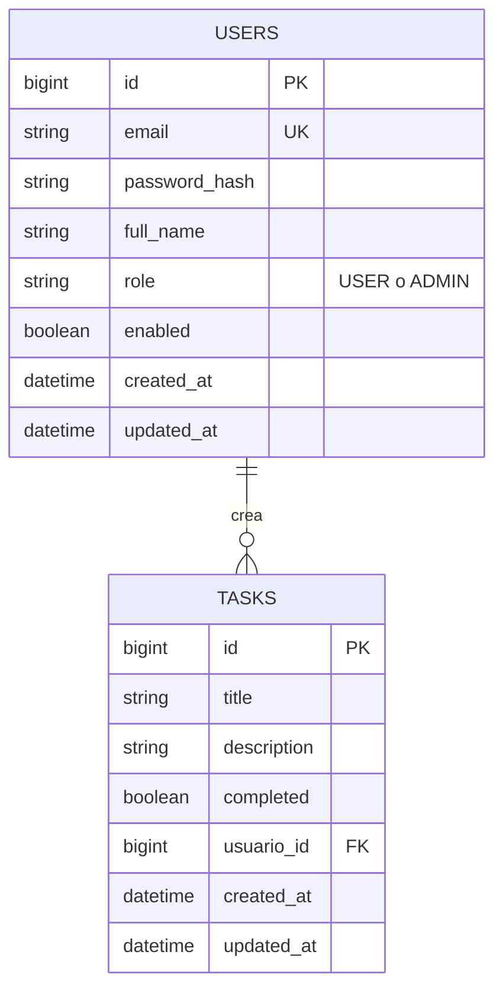

# Guía para reaprender Spring Boot (stack actualizado a octubre de 2026)

> Versiones verificadas el **6 de octubre de 2026**. Antes de iniciar un proyecto, vuelve a confirmar el último parche en [start.spring.io](https://start.spring.io), porque estas versiones cambian rápido.

**Resumen de decisiones de este proyecto**

| Tema | Decisión |
|---|---|
| Sistema operativo / editor | Ubuntu Linux + VS Code |
| JDK | Temurin 25 (LTS), instalado con SDKMAN |
| Build | Maven (con Maven Wrapper `./mvnw`) |
| Empaquetado | Jar |
| Base de datos | **MySQL** (en Docker, vía Docker Compose) |
| Migraciones | Flyway |
| Modelo de datos | Solo dos tablas: `users` y `tasks` |
| Roles | `USER` y `ADMIN` |
| Regla de acceso | El usuario normal ve solo sus tareas; el administrador ve todas |
| Documentación de la API | Swagger UI con springdoc-openapi 3.1.x |

---

## 1. Versiones recomendadas

| Pieza | Recomendación | Notas |
|---|---|---|
| **JDK** | **25 (LTS)** | Plan B: Java 21 (también LTS) si tu hosting, CI o herramientas aún no soportan 25 |
| **Spring Boot** | **4.1.x** | 4.1.0 salió el 10/06/2026; 4.1.1 el 20/08/2026. No uses milestones (4.2.0-M1) |
| **Spring Framework** | 7.0.x | Lo gestiona Boot |
| **Spring Security** | 7.1.x | Lo gestiona Boot |
| **Spring Data / JPA** | Spring Data 2026.0.x | Lo gestiona Boot |
| **Hibernate** | 7.x | Implementación de JPA |
| **Jackson** | 3.1.x | Cambio importante de paquetes (ver sección 4) |
| **Servidor embebido** | Tomcat 11 (Servlet 6.1) | |
| **Build** | Maven 3.6.3+ o Gradle 8.14+ / 9.x | Usa el Maven Wrapper del proyecto |
| **Base de datos** | MySQL 8.x o superior | En Docker, con un tag de versión fija (nunca `latest`) |
| **Swagger / OpenAPI** | springdoc-openapi **3.1.x** | No está en el BOM de Boot: hay que poner la versión a mano |

### Por qué estas elecciones

- **JDK 25:** Spring Boot 4.1 requiere como mínimo Java 17 y es compatible hasta Java 26. Java 25 es la LTS vigente; los releases intermedios (26, 27) no son LTS y no conviene usarlos en un proyecto serio.
- **Boot 4.1 y no 3.x:** todas las ramas 3.x perdieron soporte OSS en junio de 2026, así que los parches gratuitos de seguridad están en 4.x.
- **Boot 4.1 y no 4.0:** el soporte OSS de 4.0 termina el 31 de diciembre de 2026. Un proyecto nuevo debe nacer en 4.1.
- **No fijes versiones a mano** de Spring Security, Hibernate ni Spring Data. Usa el parent/BOM de Boot, que ya las gestiona de forma compatible. La excepción es springdoc.

### Aviso de compatibilidad

Boot 4 es relativamente nuevo. Antes de adoptar librerías de terceros (springdoc-openapi, MapStruct, JJWT, etc.), confirma que soportan **Boot 4 y Jackson 3**.

---

## 2. Preparar el entorno (Ubuntu + VS Code)

### 2.1 Java y Maven

Verifica lo que tienes instalado:

```bash
sdk current java
java -version
javac -version
mvn -version
```

Resultado esperado: `25-tem` (Eclipse Temurin 25). Si falta, instálalo con SDKMAN:

```bash
sdk install java 25-tem
```

**Sobre Maven:** el Maven que instala Ubuntu con `apt` suele ser la 3.8.x. Cumple el mínimo de Boot 4.1 (3.6.3+), pero es antiguo. Dos opciones:

1. **Usar el Maven Wrapper (recomendado).** Los proyectos de start.spring.io incluyen `mvnw`, que descarga y usa la versión de Maven que el proyecto necesita:
   ```bash
   ./mvnw spring-boot:run
   ./mvnw clean test
   ```
2. **Actualizar Maven con SDKMAN:**
   ```bash
   sdk install maven
   ```

### 2.2 Docker

Necesitas Docker para levantar MySQL con Docker Compose:

```bash
docker --version
docker compose version
docker ps
```

Si `docker ps` da un error de permisos, añade tu usuario al grupo `docker` y vuelve a iniciar sesión.

### 2.3 Extensiones de VS Code

**Esenciales:**

| Extensión | Para qué sirve | ID |
|---|---|---|
| Language Support for Java™ by Red Hat | Autocompletado, navegación y refactor | `redhat.java` |
| Debugger for Java | Depurar con breakpoints | `vscjava.vscode-java-debug` |
| Test Runner for Java | Ejecutar tests JUnit | `vscjava.vscode-java-test` |
| Maven for Java | Goals y árbol de dependencias | `vscjava.vscode-maven` |
| Project Manager for Java | Explorador de proyecto | `vscjava.vscode-java-dependency` |
| Spring Boot Tools | Ayuda para `application.yml`, beans y endpoints | `vmware.vscode-spring-boot` |
| Spring Initializr Java Support | Crear proyectos y editar dependencias | `vscjava.vscode-spring-initializr` |
| Spring Boot Dashboard | Iniciar, parar y depurar apps | `vscjava.vscode-spring-boot-dashboard` |

**Recomendadas:**

| Extensión | Por qué | ID |
|---|---|---|
| Docker (Microsoft) | Gestionar contenedores y editar `compose.yaml` | `ms-azuretools.vscode-docker` |
| YAML (Red Hat) | Validación de `application.yml` | `redhat.vscode-yaml` |
| XML (Red Hat) | Mejor edición del `pom.xml` | `redhat.vscode-xml` |
| Database Client (cweijan) | Ver tus tablas MySQL desde VS Code | `cweijan.vscode-database-client2` |

Instalación de todas con un solo comando:

```bash
for ext in \
  redhat.java \
  vscjava.vscode-java-debug \
  vscjava.vscode-java-test \
  vscjava.vscode-maven \
  vscjava.vscode-java-dependency \
  vmware.vscode-spring-boot \
  vscjava.vscode-spring-initializr \
  vscjava.vscode-spring-boot-dashboard \
  ms-azuretools.vscode-docker \
  redhat.vscode-yaml \
  redhat.vscode-xml \
  cweijan.vscode-database-client2
do
  code --install-extension "$ext"
done
```

**Si VS Code no detecta tu JDK** (instalado con SDKMAN): abre VS Code desde la terminal con `code .` dentro del proyecto, o configura en `settings.json`:

```json
"java.jdt.ls.java.home": "/home/user/.sdkman/candidates/java/current"
```

**Ajuste importante de Spring Initializr:** el valor por defecto de `spring.initializr.defaultJavaVersion` es `11`. Cámbialo a `25` en Settings, o elige la versión manualmente en el asistente.

---

## 3. Cómo detectar tutoriales desactualizados

Cada vez que veas un video o artículo, revisa la fecha y el `pom.xml`. Estas son las señales de que está obsoleto:

| Señal obsoleta | Lo moderno |
|---|---|
| `javax.*` | `jakarta.*` (desde Boot 3) |
| `WebSecurityConfigurerAdapter` | Bean `SecurityFilterChain` |
| `authorizeRequests()` / `antMatchers()` | `authorizeHttpRequests()` / `requestMatchers()` |
| `@EnableGlobalMethodSecurity` | `@EnableMethodSecurity` |
| Encadenar con `.and()` | Lambda DSL (en Security 7 se eliminó el encadenado) |
| `spring-boot-starter-web` monolítico | Starters modulares (p. ej. `spring-boot-starter-webmvc`) |
| Jackson 2 (`com.fasterxml.jackson.core/databind`) | Jackson 3 (`tools.jackson.*`; las anotaciones se mantienen) |
| `RestTemplate` | `RestClient` |
| `springdoc-openapi-ui` 1.x o Springfox | `springdoc-openapi-starter-webmvc-ui` 3.x |

---

## 4. Cambios clave de Boot 4 / Spring 7 que debes conocer

- **Starters modulares:** el autoconfigure monolítico se dividió en módulos por tecnología. Si generas el proyecto desde start.spring.io, ya vienen los starters correctos.
- **Spring Security 7:** se eliminaron APIs deprecadas. Por ejemplo, `DaoAuthenticationProvider` ahora exige el `UserDetailsService` en el constructor. Lee la guía de migración.
- **Jackson 3:** nuevos paquetes `tools.jackson.*`.
- **Hibernate 7 / Jakarta Persistence 3.2.**
- **Null-safety con JSpecify** en todo el ecosistema Spring.
- **Clientes HTTP:** `RestClient` y `@ImportHttpServices` para clientes declarativos.
- **Versionado de APIs** integrado en Spring Framework 7.

---

## 5. Cómo estudiar

### Fuentes confiables (siempre con el selector de versión correcto)

- Documentación de [Spring Boot](https://docs.spring.io/spring-boot/) y de [Spring Security](https://docs.spring.io/spring-security/reference/). Confirma que estás en 4.1 / 7.1.
- El wiki de GitHub de Spring Boot: *Release Notes* y *Migration Guide* de 4.0 y 4.1. Es lo más útil para saber qué cambió.
- La guía de migración de Hibernate 7.
- El blog de [spring.io](https://spring.io/blog) y los cursos gratuitos de [Spring Academy](https://spring.academy).
- YouTube: el canal oficial *Spring Developer* (Josh Long) y Dan Vega. Filtra por videos posteriores a noviembre de 2025, cuando salió Boot 4.0.

### Orden de estudio

1. **Núcleo:** IoC/DI, beans, configuración con `application.yml` y profiles.
2. **REST con Web MVC:** DTOs con `record`, Bean Validation y errores con `ProblemDetail`.
3. **Data JPA / Hibernate:** relaciones, `LAZY`, N+1, paginación y migraciones con Flyway.
4. **Security:** autenticación, roles, configuración manual de JWT (generación y validación mediante filtros) y autorización.
5. **Testing:** slices (`@WebMvcTest`, `@DataJpaTest`) y Testcontainers con `@ServiceConnection`.
6. **Actuator, Docker y despliegue.**

### Aprende en un proyecto pequeño, no en el de la startup

Haz primero la API de práctica de la sección 7. Cuando te sientas cómodo, tendrás una plantilla base para el proyecto serio.

---

## 6. Buenas prácticas desde el día uno

- Inyección por constructor.
- DTOs separados de las entidades (usa `record`).
- Nada de `ddl-auto=update`: usa **Flyway** con `ddl-auto: validate`.
- `spring.jpa.open-in-view: false`.
- Relaciones `LAZY` por defecto y cuidado con el N+1.
- Evita `@Data` de Lombok en entidades.
- Secretos y credenciales por variables de entorno.
- Hash de contraseñas con `DelegatingPasswordEncoder` (BCrypt por defecto).
- Para JWT, implementa tu propio filtro personalizado (ej. extendiendo `OncePerRequestFilter`) y utiliza una librería sólida (como JJWT o auth0/java-jwt) para la firma y validación del token.
- Errores de la API con `ProblemDetail`.
- Tests con Testcontainers en vez de bases de datos en memoria distintas a producción.

---

## 7. Proyecto de práctica: "TaskFlow" (lista de tareas con roles)

### 7.1 Requerimientos

- API REST de lista de tareas, construida con las versiones y buenas prácticas de esta guía.
- Base de datos **MySQL** con migraciones Flyway.
- Solo dos entidades: **usuarios** y **tareas**.
- Cada usuario tiene un rol: **usuario normal (`USER`)** o **administrador (`ADMIN`)**.
- Un usuario normal **solo ve las tareas que él creó**.
- Un administrador **ve todas las tareas** creadas por todos los usuarios del sistema.
- Swagger UI para probar los endpoints.

### 7.2 Dependencias iniciales (asistente de Spring Initializr)

| Dependencia en el asistente | Para qué sirve |
|---|---|
| **Spring Web** | API REST con Spring MVC (Tomcat embebido) |
| **Validation** | Bean Validation (`@NotBlank`, `@Size`, etc.) |
| **Spring Data JPA** | JPA con Hibernate y repositorios |
| **MySQL Driver** | Driver de la base de datos (elige MySQL, **no** MariaDB) |
| **Flyway Migration** | Migraciones de base de datos versionadas |
| **Docker Compose Support** | Boot levanta tu `compose.yaml` y configura el datasource solo |
| **Spring Boot DevTools** | Reinicio automático al guardar cambios |

**Se añaden después:**

| Dependencia | Cuándo | Nota |
|---|---|---|
| **Spring Security** | Fase 3 | Si la marcaste desde el inicio, **comenta `spring-boot-starter-security` en el `pom.xml`** hasta la Fase 3: en cuanto está presente, todos los endpoints quedan bloqueados (401) y complica las pruebas del CRUD en Swagger |
| **Librería JWT (ej. JJWT)** | Fase 3 | Se añade a mano en el `pom.xml` para generar y validar los tokens JWT |
| **Spring Boot Actuator** | Fase 5 | Health checks y métricas |
| **Testcontainers** | Fase 4 | Tests con MySQL real en contenedor (necesitarás también su módulo de MySQL) |
| **springdoc-openapi** | Fase 0 | No aparece en el asistente: se añade a mano (sección 8) |

**Notas sobre MySQL:**

- Si al arrancar ves un error como `Unsupported Database: MySQL`, añade al `pom.xml` (sin versión, la gestiona el BOM de Boot):
  ```xml
  <dependency>
      <groupId>org.flywaydb</groupId>
      <artifactId>flyway-mysql</artifactId>
  </dependency>
  ```
  Puede que el asistente ya lo incluya: revisa el `pom.xml` antes de añadirlo.
- Para cambios posteriores de dependencias en un proyecto existente: `Ctrl+Shift+P` → *Spring Initializr: Edit Starters*.

**Crear el proyecto desde la terminal (alternativa al asistente de VS Code):**

```bash
curl https://start.spring.io/starter.zip \
  -d type=maven-project \
  -d language=java \
  -d javaVersion=25 \
  -d groupId=com.example \
  -d artifactId=taskflow \
  -d name=taskflow \
  -d packageName=com.example.taskflow \
  -d dependencies=web,validation,data-jpa,mysql,flyway,docker-compose,devtools \
  -o taskflow.zip

unzip taskflow.zip -d taskflow && cd taskflow
```

No se indica `bootVersion` para usar la versión estable por defecto. Verifica en el `pom.xml` generado que sea 4.1.x.

### 7.3 Modelo de datos

Una sola relación: **un usuario crea muchas tareas, y cada tarea pertenece a un solo usuario.**



**Tabla `users`**

| Columna | Tipo | Restricciones | Descripción |
|---|---|---|---|
| `id` | BIGINT | PK, AUTO_INCREMENT | Identificador |
| `email` | VARCHAR(255) | NOT NULL, UNIQUE | Se usa para iniciar sesión |
| `password_hash` | VARCHAR(255) | NOT NULL | Contraseña hasheada (nunca en texto plano) |
| `full_name` | VARCHAR(100) | NOT NULL | Nombre completo |
| `role` | VARCHAR(20) | NOT NULL, CHECK (`USER`, `ADMIN`) | Rol del usuario |
| `enabled` | BOOLEAN | NOT NULL, por defecto verdadero | Permite desactivar sin borrar |
| `created_at`, `updated_at` | DATETIME(6) | NOT NULL | Auditoría, en UTC |

**Tabla `tasks`**

| Columna | Tipo | Restricciones | Descripción |
|---|---|---|---|
| `id` | BIGINT | PK, AUTO_INCREMENT | Identificador |
| `title` | VARCHAR(120) | NOT NULL | Título |
| `description` | VARCHAR(1000) | NULL | Detalle opcional |
| `completed` | BOOLEAN | NOT NULL, por defecto falso | Si la tarea está terminada |
| `usuario_id` | BIGINT | NOT NULL, FK → `users.id`, indexada | Usuario que creó la tarea |
| `created_at`, `updated_at` | DATETIME(6) | NOT NULL | Auditoría, en UTC |

**Relación en español:** el usuario *crea* tareas. Al borrar un usuario se aplica `RESTRICT`: no se puede eliminar a quien tenga tareas. Para quitar a alguien se desactiva (`enabled = false`).


### 7.5 Reglas de acceso

| Acción | Usuario normal (`USER`) | Administrador (`ADMIN`) |
|---|---|---|
| Listar tareas | Solo las suyas | Todas |
| Ver una tarea por ID | Solo si es suya | Cualquiera |
| Crear tarea | Queda siempre a su nombre | Queda a su nombre |
| Editar o borrar | Solo las suyas | Cualquiera *(por confirmar, ver nota)* |

> **Por confirmar:** se asumió que el administrador también puede **editar y borrar** las tareas de otros usuarios, no solo verlas. Si debe ser solo de consulta, se ajusta en el servicio.

**Reglas de seguridad importantes:**

- Si un usuario normal pide una tarea ajena, responde **404, no 403**. Así no se le confirma que esa tarea existe.
- El endpoint de registro **nunca acepta el rol** desde el cuerpo de la petición. Siempre crea usuarios `USER`; si no, cualquiera podría registrarse como administrador.
- El primer administrador se crea con una migración de Flyway o al arrancar la aplicación. Los demás los promueve otro administrador.

Implementación en el servicio (Fase 3), en esencia:

```java
Page<Task> tasks = isAdmin
        ? repository.findAll(pageable)
        : repository.findByOwnerId(currentUserId, pageable);
```

### 7.6 Endpoints

| Método | Ruta | Descripción | Acceso |
|---|---|---|---|
| POST | `/api/auth/register` | Registro de usuario (siempre rol `USER`) | Público |
| POST | `/api/auth/login` | Login, devuelve JWT | Público |
| GET | `/api/tasks` | Lista paginada: las propias (`USER`) o todas (`ADMIN`) | Autenticado |
| GET | `/api/tasks/{id}` | Detalle (404 si no tiene permiso) | Autenticado |
| POST | `/api/tasks` | Crear tarea a nombre del usuario autenticado | Autenticado |
| PUT / PATCH | `/api/tasks/{id}` | Actualizar | Autenticado |
| DELETE | `/api/tasks/{id}` | Eliminar | Autenticado |

Opcional, como ejercicio extra: un endpoint solo para `ADMIN` que permita promover a otro usuario.

### 7.7 Fases

Cada fase debe terminar funcionando en Swagger UI.

#### Fase 0: base

- [ ] Entorno verificado (sección 2).
- [ ] Proyecto generado (asistente de VS Code o `curl`) con Java 25.
- [ ] `spring-boot-starter-security` comentada en el `pom.xml` si se marcó.
- [ ] `compose.yaml` con MySQL (imagen con versión fija). Con *Docker Compose Support*, Boot lo levanta y configura el datasource automáticamente.
- [ ] Dependencia de springdoc añadida (sección 8).

#### Fase 1: CRUD de tareas sin seguridad

Todavía no hay login, así que mientras tanto las tareas se asignan a un **usuario de prueba** creado por una migración de datos (por ejemplo, un `id` fijo). En la Fase 3 se reemplaza por el usuario autenticado.

- [ ] DTOs como `record` con Bean Validation.
- [ ] `@RestControllerAdvice` que devuelva errores como `ProblemDetail`.
- [ ] Estructura Controller → Service → Repository con inyección por constructor.

```java
public record CreateTaskRequest(
        @NotBlank @Size(max = 120) String title,
        @Size(max = 1000) String description) {}
```

```java
@RestController
@RequestMapping("/api/tasks")
@Tag(name = "Tasks", description = "Gestión de tareas")
class TaskController {

    private final TaskService service;

    TaskController(TaskService service) { this.service = service; }

    @Operation(summary = "Crear una tarea")
    @PostMapping
    ResponseEntity<TaskResponse> create(@Valid @RequestBody CreateTaskRequest request) {
        // ...
    }
}
```

`@Tag` y `@Operation` son anotaciones de Swagger. Son opcionales, pero te enseñan a documentar la API.

#### Fase 2: JPA bien hecho

- [ ] Migración Flyway `V1__create_tables.sql` con `users` y `tasks`, incluyendo la restricción `CHECK` del rol, la clave foránea `owner_id` y su índice.
- [ ] Usuarios de prueba (migración de datos): un administrador y dos usuarios normales.
- [ ] `ddl-auto: validate` y `spring.jpa.open-in-view: false`.
- [ ] Entidades `User` y `Task` con `@ManyToOne(fetch = LAZY)`.
- [ ] Paginación con `Pageable` y consulta derivada `findByOwnerId`.
- [ ] Provocar un N+1 a propósito (listar todas las tareas y leer `task.getOwner()`) y corregirlo con `@EntityGraph`.
- [ ] Auditoría de `createdAt` y `updatedAt`.

#### Fase 3: Security (roles y propiedad)

- [ ] Reactivar Spring Security y añadir la dependencia de tu librería JWT (ej. JJWT).
- [ ] Registro con `BCrypt` (o `DelegatingPasswordEncoder`). Siempre crea usuarios `USER`.
- [ ] Configuración de la autenticación (`AuthenticationManager` o servicio similar) y endpoint de Login que emite un JWT con los reclamos (claims) y rol del usuario.
- [ ] Creación de un filtro personalizado (ej. `JwtAuthenticationFilter` extendiendo `OncePerRequestFilter`) para interceptar las peticiones y validar el token usando la librería JWT.
- [ ] Reglas de acceso de la sección 7.5: filtrar por `owner_id` para `USER`, sin filtro para `ADMIN`; 404 ante tareas ajenas.
- [ ] Reemplazar el usuario de prueba de la Fase 1 por el usuario autenticado (extrayéndolo del `SecurityContextHolder`).
- [ ] **Permitir `/swagger-ui/**` y `/v3/api-docs/**`** en el `SecurityFilterChain`.
- [ ] Declarar un `@SecurityScheme` (HTTP bearer, JWT) para que aparezca el botón **Authorize** en Swagger UI.

#### Fase 4: tests

- [ ] `@DataJpaTest` + Testcontainers con MySQL (`@ServiceConnection`) para repositorios.
- [ ] `@WebMvcTest` para controllers.
- [ ] Tests de seguridad: 401 sin token, usuario normal que no ve tareas ajenas (404), administrador que ve todas, y registro que no permite elegir rol.

#### Fase 5: cierre

- [ ] Actuator.
- [ ] Perfiles `dev` / `prod`.
- [ ] Dockerfile.
- [ ] `springdoc.swagger-ui.enabled=false` en producción.

---

## 8. Swagger UI con springdoc-openapi

Lo que usarás es **springdoc-openapi**: genera la documentación OpenAPI y sirve el Swagger UI.

### Versión

- La línea **3.x** es la compatible con Spring Boot 4.
- La **3.1.0** fue la que actualizó la base a Spring Boot **4.1.0**; la 3.0.x apuntaba al rango de Boot 4.0. Como usas 4.1.x, elige **3.1.x**.
- Confirma el último 3.1.x en [Maven Central](https://central.sonatype.com/artifact/org.springdoc/springdoc-openapi-starter-webmvc-ui) o en [springdoc.org](https://springdoc.org).

```xml
<dependency>
    <groupId>org.springdoc</groupId>
    <artifactId>springdoc-openapi-starter-webmvc-ui</artifactId>
    <version>3.1.1</version>
</dependency>
```

### URLs

| Recurso | Ruta |
|---|---|
| Swagger UI | `/swagger-ui/index.html` |
| Especificación JSON | `/v3/api-docs` |

### Cómo probar un endpoint

1. Abre `/swagger-ui/index.html`.
2. Expande un endpoint y pulsa **Try it out**.
3. Edita el JSON de ejemplo y pulsa **Execute**.
4. Revisa el código de estado, el cuerpo de respuesta y el `curl` generado.
5. Prueba también los errores (título vacío, ID inexistente) para comprobar que tu `ProblemDetail` responde bien.

### Con Security activo

Permite en el `SecurityFilterChain` las rutas `/swagger-ui/**` y `/v3/api-docs/**`. Declara un esquema bearer para habilitar el botón **Authorize**:

```java
@SecurityScheme(
        name = "bearerAuth",
        type = SecuritySchemeType.HTTP,
        scheme = "bearer",
        bearerFormat = "JWT")
```

Luego pega el token que obtienes en `/api/auth/login`. Para probar las reglas de acceso, inicia sesión como usuario normal y como administrador, y compara las respuestas de `GET /api/tasks`.

### Producción

Desactiva Swagger UI en el perfil `prod`:

```yaml
springdoc:
  swagger-ui:
    enabled: false
```

---

## 9. Configuración base sugerida (`application.yml`)

```yaml
spring:
  jpa:
    open-in-view: false
    hibernate:
      ddl-auto: validate
  threads:
    virtual:
      enabled: true   # opcional: hilos virtuales (Java 21+)
```

El datasource lo configura Docker Compose Support en desarrollo. En producción, usa variables de entorno.

---

## 10. Pendientes y supuestos

- [ ] Confirmar si el administrador puede **editar y borrar** tareas ajenas o solo consultarlas.
- [ ] Escribir el `compose.yaml` con MySQL y la migración `V1__create_tables.sql`.
- [ ] Crear las entidades JPA y los repositorios.
- [ ] Probar el primer CRUD de `Task` en Swagger UI.

---

## 11. Fuentes consultadas

- [Spring Boot 4.1.0 available now](https://spring.io/blog/2026/06/10/spring-boot-4/) (spring.io, 10/06/2026)
- [Spring Boot 4.1.1 available now](https://spring.io/blog/2026/08/20/spring-boot-4-1-1-available-now/) (spring.io, 20/08/2026)
- [System Requirements, Spring Boot](https://docs.spring.io/spring-boot/system-requirements.html) (Java 17 mínimo, compatible hasta Java 26)
- [Spring Boot 4: Everything You Need to Know](https://www.danvega.dev/blog/2025/11/24/spring-boot-4-is-here) (Dan Vega)
- [springdoc-openapi](https://springdoc.org/) y sus [releases en GitHub](https://github.com/springdoc/springdoc-openapi/releases)
- [Spring Boot Extension Pack](https://marketplace.visualstudio.com/items/?itemName=vmware.vscode-boot-dev-pack) y [Spring Initializr Java Support](https://marketplace.visualstudio.com/items/vscjava.vscode-spring-initializr) (VS Code Marketplace)